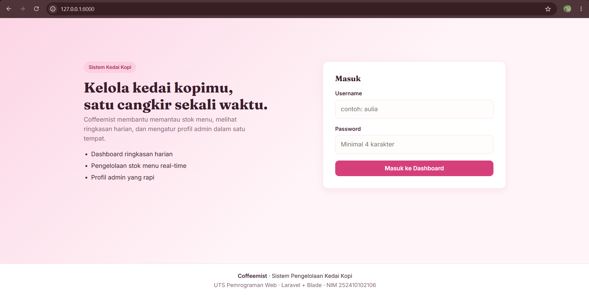
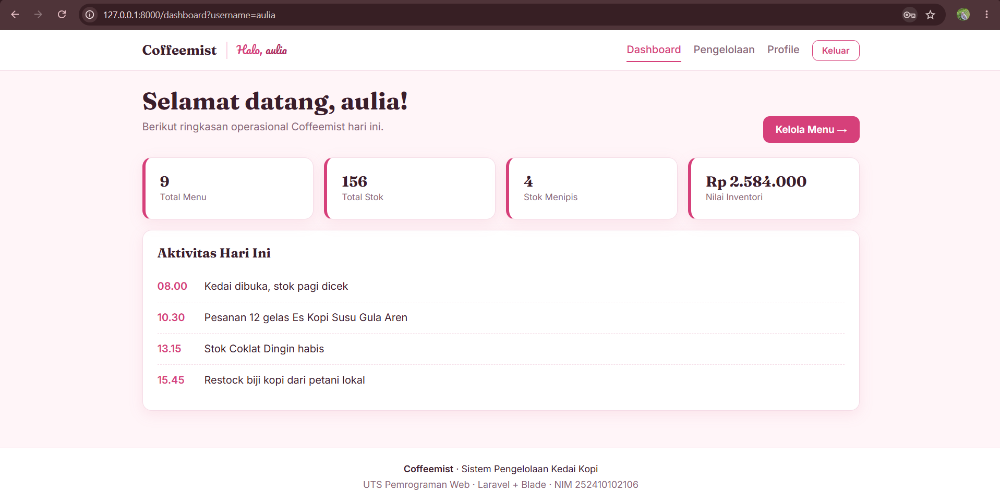
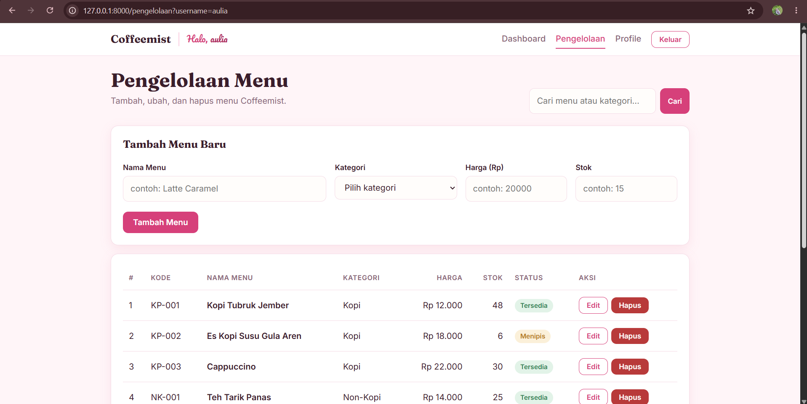
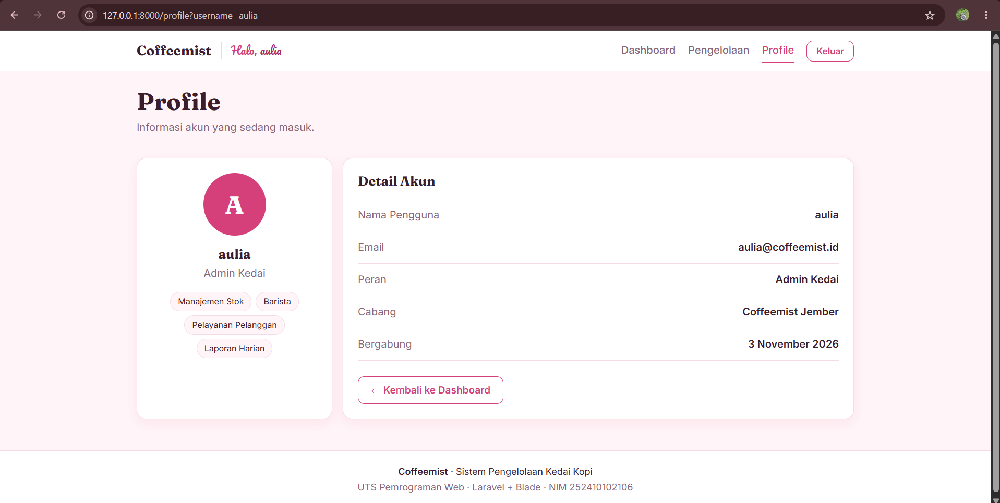

# UTS PWEB — Coffeemist (Laravel + Blade, MVC)

**NIM:** 252410102106

Aplikasi web **Coffeemist**: sistem pengelolaan kedai kopi sederhana yang dibuat dengan Laravel murni (tanpa template UI siap pakai) untuk mempelajari alur **request → route → controller → view → response**.

## Fitur

- **Login (simulasi)** — form username & password, divalidasi di controller, lalu `redirect` ke dashboard membawa `?username=...`.
- **Dashboard** — menyapa pengguna, menampilkan kartu statistik dan aktivitas hari ini (data array dari controller, di-loop dengan `@foreach`).
- **Pengelolaan** — tabel menu kedai (kode, nama, kategori, harga, stok, status) dari array di controller, lengkap dengan pencarian dan `@forelse`.
- **Profile** — detail akun; username diteruskan lewat request parameter.
- **Responsif** — navbar hamburger di layar kecil, tabel berubah menjadi kartu di mobile.

## Struktur File

```
routes/web.php
app/Http/Controllers/PageController.php
resources/views/
├── layouts/app.blade.php
├── login.blade.php
├── dashboard.blade.php
├── pengelolaan.blade.php
├── profile.blade.php
├── components/
│   ├── navbar.blade.php
│   └── footer.blade.php
└── partials/
    ├── head.blade.php
    └── stat-card.blade.php
public/css/style.css
```

## Penerapan Konsep

| Konsep | Lokasi |
| --- | --- |
| MVC (view dipanggil dari controller) | `PageController` memanggil `view(...)` |
| `@extends` | semua view halaman |
| `@section` / `@endsection` | semua view halaman |
| `@yield` | `layouts/app.blade.php` |
| `@include` | `layouts/app` → `partials.head`, `dashboard` → `partials.stat-card` |
| `x-component` | `<x-navbar>` dan `<x-footer>` di layout |
| Request parameter | `?username=` dibaca lewat `$request->query('username')` |
| Array rendering | `@foreach` / `@forelse` pada dashboard, pengelolaan, profile |

## Cara Menjalankan

```bash
composer create-project laravel/laravel UTS_PWEB_252410102106
cd UTS_PWEB_252410102106

php artisan serve
```

Buka `http://127.0.0.1:8000`, isi username & password bebas (min. 3 dan 4 karakter).

## Screenshot

| Login | Dashboard |
| --- | --- |
|  |  |

| Pengelolaan | Profile |
| --- | --- |
|  |  |
